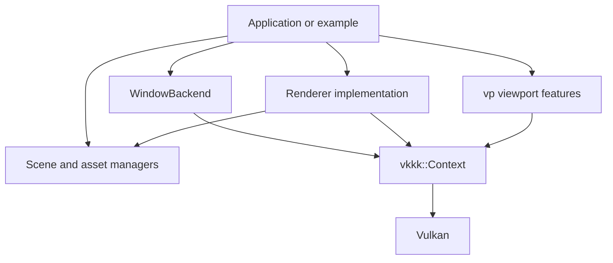

# vkkk Project Structure

## 1. Purpose

`vkkk` is a C++20 Vulkan rendering toolkit. It provides:

- Vulkan instance/device, swapchain, synchronization, command recording, and presentation.
- Graphics and compute pipeline creation with GLSL/SPIR-V reflection.
- Named mesh, line, point, texture, render-target, depth, and buffer resources.
- Forward and Forward+ rendering helpers, including instanced SSBO-based drawing.
- A composable viewport layer for scene features, overlays, and picking.
- Optional GLFW, Qt, ImGui, font, CUDA-interoperability, and Python-binding integrations.

The intended ownership boundary is:



Applications own the window backend, scene data, camera, and renderer. `Context` owns Vulkan resources and frame synchronization. `vp` is a non-owning orchestration layer over an initialized `Context`.

## 2. Repository layout

| Path | Responsibility |
| --- | --- |
| `src/vk_ins/` | Low-level Vulkan wrapper. `Context` owns the device, swapchain, pipelines, descriptors, GPU buffers, render targets, command buffers, and frame lifecycle. |
| `src/renderer/` | Rendering strategies and common renderer helpers. The active CMake path uses `renderer.hpp`, `forward.cpp`, and `forwardp.cpp`. |
| `src/asset_mgr/` | `Scene`, CPU-side mesh management, and per-pipeline light storage. |
| `src/concepts/` | CPU domain types: `Mesh`, `MeshView`, `Lines`, `Points`, `Camera`, and related geometry types. |
| `src/built_in_shader/` | CPU-side UBO/SSBO layouts paired with inline GLSL for built-in materials and viewport effects. |
| `src/vp/` | Header-oriented viewport framework and feature modules for axes, grids, object picking, and vertex picking. |
| `src/gui/` | Window/surface abstraction, GLFW and Qt backends, input types, and ImGui integration. |
| `src/font/` | Font-to-render-target text rendering. |
| `src/binding/` | Nanobind source for the optional `pyvkkk` module. |
| `src/control/` | Small input/callback support layer. |
| `resource/shaders/` | File-based GLSL used by renderer and picking paths. |
| `examples/` | GLFW rendering examples, viewport example, and Qt example. |
| `thirdparty/` | ImGui, nanobind, and other vendored dependencies. |
| `plugin/` | Packaging support for the Python plugin output. |
| `vp_design.md` | Forward-looking design document for the viewport toolkit. |

The root CMake project builds the `vkkk` library and the example subdirectory. It uses C++20 and requires Vulkan, GLM, shaderc, SPIRV-Cross, fmt, OpenImageIO, Assimp, minizip-ng, and FreeType. GLFW and Qt6 are optional window backends.

## 3. Main subsystems

### 3.1 Vulkan backend: `src/vk_ins/`

`Context` is the central low-level API. It uses Vulkan-Hpp RAII handles and exposes both a convenient named-resource API and lower-level Vulkan escape hatches.

The backend is split across:

- `context.hpp` / `context.cpp`: public types, `Context`, initialization, and shared implementation.
- `context_pipeline.cpp`: graphics/compute pipeline creation and reflected descriptors.
- `context_commands.cpp`: binding, indexed/instanced drawing, mesh-task drawing, indirect drawing, push constants, and compute dispatch.
- `context_resources.cpp`: UBO/SSBO synchronization, textures, render targets, and depth resources.
- `context_abuffer.cpp`: linked-list A-buffer support for overlap-safe picking.
- `context_billboard.cpp`: camera-facing text billboards.
- `context_cuda.cpp`: CUDA/Vulkan external-memory paths.
- `context_utils.cpp`: common Vulkan resource and utility operations.

Important public data types include:

- `Pipeline`, `ComputePipeline`, and `PipelineOption`.
- `UBO`, `SSBO`, `Texture`, `DepthAttachment`, and `PushConstantBlock`.
- `MeshGPU`, `DeformableMeshGPU`, `LinesGPU`, `PointsGPU`, and `IndirectBuffer`.
- `PassDesc`, `PassLoadOp`, and `PassStoreOp`.
- `BillboardTextSource`, `BillboardTextOptions`, and related billboard types.

### 3.2 Rendering strategies: `src/renderer/`

`Renderer` is the common application-facing base. It holds non-owning pointers to `Context` and `Scene`, provides pipeline-from-source helpers, and provides common camera/light UBO and SSBO synchronization.

Active strategy implementations:

- `ForwardRenderer`: forward opaque/transparent rendering with a shadow pass, batching, and optional overlay drawing.
- `ForwardPRenderer`: Forward+ rendering with opaque/transparent instance batches, per-pipeline SSBO allocation, and clustered point-light preparation.

Other files:

- `deferred.h/.cpp` contain a minimal deferred-renderer placeholder.
- `renderer.h` and `forward_plus.h/.cpp` contain an alternate renderer API generation.

The target named `vkrendererforwardplus` currently uses `ForwardPRenderer` from `renderer/forwardp.hpp`; the target name is retained for historical reasons.

### 3.3 Assets and scene data: `src/asset_mgr/`

`Scene` owns the application-facing object table and exposes pointers to the process-wide `DrawableMgr` and `LightMgr` singletons.

`DrawableMgr` manages CPU-side geometry:

- Imports Assimp meshes with `load_file`.
- Creates procedural planes, cubes, spheres, and lines.
- Looks up, removes, clears, and uploads meshes with `find_mesh`, `remove_mesh`, `clear_meshes`, and `sync_to_gpu`.

`LightMgr` stores `PipelineLightStorage`, containing point, directional, and spot-light UBO arrays keyed by pipeline name.

### 3.4 Geometry and camera concepts: `src/concepts/`

- `Mesh`: owning, packed CPU vertex/index data described by `VERT_COMP`.
- `MeshView`: non-owning view over compatible vertex/index data.
- `Lines`: indexed line-list data.
- `Points`: point-list data.
- `Camera`: camera control state plus `CameraUBO` data and view/projection helpers.
- `Curve` and related geometry helpers: used by viewport-oriented features and examples.

### 3.5 Built-in shaders: `src/built_in_shader/`

Each built-in shader header keeps the CPU buffer layout next to its inline GLSL. The shader block names and bindings must remain synchronized with `common.h` and `Context` reflection.

Available shader families include:

- Fixed-color instanced drawing.
- Phong and clustered Phong/Forward+ lighting.
- PBR material shading.
- Directional shadow-map generation and shadow resolve.
- Mesh-shader line generation and face-normal visualization.
- Light clustering compute shaders.
- Billboard text and other utility shaders.

`ShaderModule` compiles or loads GLSL/SPIR-V and reflects uniform buffers, storage buffers, images, vertex attributes, texture pairs, and push constants. `ShaderModulePack` groups shader stages into a graphics pipeline.

### 3.6 Viewport framework: `src/vp/`

`Viewport<FeatureTypes...>` is a compile-time feature composition layer. A feature must satisfy `ViewportFeatureType` and implement lifecycle hooks:

```cpp
on_attach(Context&, vk::Extent2D)
on_resize(Context&, vk::Extent2D)
on_update(Context&, const Context::Frame&)
on_record(Context&, vk::raii::CommandBuffer&, uint32_t image_index)
```

Features are assigned to one of three phases:

- `Picking`
- `Scene`
- `ScreenOverlay`

The viewport records picking first, then the scene pass, then an optional load-preserving screen-overlay pass. Current feature modules include `FrameAxisFeature`, `GridFeature`, `ObjectPickingFeature`, and `VertexPickingFeature`.

### 3.7 Windowing, UI, and input: `src/gui/`

`WindowBackend` is the toolkit-neutral surface and input contract used by `Context`. It covers:

- Vulkan instance extensions and surface creation.
- Window/framebuffer size and resize notification.
- Event polling and close state.
- Pointer, keyboard, mouse-button, and modifier state.

`GlfwBackend` and `QtBackend` implement the contract. `ImGuiHud` provides optional ImGui frame setup and Vulkan command-buffer rendering. `gui/input.hpp` defines toolkit-neutral keys, mouse buttons, modifiers, events, and cursor-to-pixel mapping.

## 4. Public interfaces

### `vkkk::Context`

Initialization and lifetime:

```cpp
Context(bool enable_debug_m = true);
void init(WindowBackend& backend, ...);
void recreate_swapchain();
void wait_idle() const;
vk::Extent2D extent() const;
```

Preferred frame lifecycle:

```cpp
Context::Frame frame;
if (ctx.begin_frame(frame)) {
    update_application_state(frame);
    ctx.record_frame(frame, [&](vk::raii::CommandBuffer& cmd, uint32_t image_index) {
        // Begin passes, bind pipelines/resources, and issue draws.
    });
    ctx.end_frame(frame);
}
```

`record_cmds` and `draw_frame` remain as convenience/legacy callback APIs. Passes are described with `PassDesc`, `begin_pass`, and `end_pass`; depth-only work can use `record_depth_pass`.

Pipeline and shader operations:

```cpp
bool load_shader(ShaderModule&, const fs::path&, vk::ShaderStageFlagBits) const;
bool create_pipeline(const std::string&, const ShaderModulePack&,
    const PipelineOption&, const std::vector<VERT_COMP>&, ...);
bool create_compute_pipeline(const std::string&, const ComputeShader&);
bool load_compute_pipeline(const std::string&, const fs::path&);
```

Named graphics operations:

```cpp
bool bind(vk::CommandBuffer, const std::string& pipeline, uint32_t frame) const;
bool draw(vk::CommandBuffer, const std::string& pipeline,
    const std::string& mesh, uint32_t instance_count,
    uint32_t instance_offset = 0, uint32_t index_count = 0) const;
bool draw_indexed(vk::CommandBuffer, const std::string& mesh,
    uint32_t index_count, uint32_t instance_count = 1,
    uint32_t instance_offset = 0) const;
bool draw_lines(...);
bool draw_points(...);
bool draw_indirect(...);
bool record_mesh_tasks(...);
bool draw_mesh_instanced(...);
```

Resource and synchronization operations include:

- `add_ubo`, `sync_ubo`, `sync_ssbo`, `alloc_pipeline_ssbo`, and `resize_pipeline_ssbo`.
- `update_push_constants` and `push_constants`.
- `add_texture`, `add_cubemap`, `bind_pipeline_texture`, and render-target binding.
- `add_render_target`, `resize_render_target`, `read_render_target_pixel`.
- `add_depth_attachment`, `resize_depth_attachment`, and depth attachment binding.
- `load_mesh`, `update_mesh`, `remove_mesh`, `clear_meshes`, `load_lines`, and `load_points`.
- Billboard creation and drawing.
- Indirect buffers, compute SSBOs, A-buffers, and CUDA interop helpers.

The public `pipelines`, `compute_pipelines`, `meshes`, `lines`, `points`, `targets`, and related maps are low-level escape hatches. New high-level behavior should generally be added as a focused `Context` method.

### `vkkk::Renderer`

The active base interface in `renderer/renderer.hpp` is:

```cpp
Renderer(Context* context, Scene* scene);
virtual bool initialize(Context*) = 0;
virtual void shutdown() = 0;
virtual void update();
virtual void record_commands(vk::CommandBuffer, uint32_t swapchain_image_idx) = 0;
virtual void on_resize(uint32_t width, uint32_t height) = 0;
virtual const char* type_name() const = 0;
```

Common helpers are `create_pipeline_from_shader_src`, `sync_uniform`, `sync_ssbo`, and `sync_uniforms`.

`ForwardPRenderer` additionally exposes:

```cpp
void add_opaque_drawable(const std::string& mesh, const std::string& pipeline,
    size_t instance_attr_size, const char* data);
void add_transparent_drawable(...);
void allocate_ssbo();
void prepare_light_clusters(vk::CommandBuffer, uint32_t swapchain_image_idx);
void set_max_lights_per_cluster(uint32_t count);
```

`ForwardRenderer` exposes equivalent opaque/transparent drawable batching, `allocate_ssbo`, `pass_shadow`, `shadow_depth_attachment_index`, and `set_overlay_draw`.

### Scene and asset interfaces

```cpp
Scene();
bool add_object(std::string name, std::string mesh_name,
    glm::mat4 model = glm::mat4{1.0f});
bool remove_object(const std::string& name);
void clear_objects();
SceneObject* find_object(const std::string& name);
const SceneObject* find_object(const std::string& name) const;
size_t object_count() const;
```

```cpp
void DrawableMgr::load_file(...);
void DrawableMgr::load_mesh(...);
void DrawableMgr::add_plane(...);
void DrawableMgr::add_cube(...);
void DrawableMgr::add_sphere(...);
void DrawableMgr::add_line(...);
const Mesh* DrawableMgr::find_mesh(const std::string&) const;
Mesh* DrawableMgr::find_mesh(const std::string&);
void DrawableMgr::sync_to_gpu(Context*);
```

```cpp
void LightMgr::register_pipeline(const std::string&, const PipelineLightStorage&);
void LightMgr::unregister_pipeline(const std::string&);
const PipelineLightStorage* LightMgr::pipeline_storage(const std::string&) const;
```

### Viewport interface

```cpp
using EditorViewport =
    vkkk::vp::Viewport<vkkk::vp::FrameAxisFeature,
                       vkkk::vp::GridFeature>;

EditorViewport viewport(context);
auto handle = viewport.add_feature<vkkk::vp::GridFeature>(camera);
viewport.begin_frame(frame);
viewport.update(frame);
viewport.record_frame(frame);
viewport.end_frame(frame);
```

Feature-specific public operations include:

- `FrameAxisFeature`: camera, font path, coordinate-system labels, and `visible`.
- `GridFeature`: camera, cell count/size, and `visible`.
- `ObjectPickingFeature`: add/clear objects, pick callback, picked object ID, and `enabled`.
- `VertexPickingFeature`: set/clear point lists, point transform, pick callback, picked vertex IDs, overflow state, and `enabled`.

### Window and UI interfaces

Applications can implement `WindowBackend` for another window system by implementing surface creation, sizing, event polling, close/resize state, and input queries. Existing implementations are `GlfwBackend` and `QtBackend`.

`ImGuiHud` exposes `init`, `begin_frame`, `build_default_hud`, `render`, and `shutdown`. `font::TextRenderer` exposes `render(Context&, std::string_view, TextRenderOptions)` and returns a `TextTexture`.

## 5. Typical rendering flow

1. Construct a `GlfwBackend` or `QtBackend`.
2. Construct and initialize `Context` with the backend.
3. Create a `Scene`, assign its camera, add/import meshes through `DrawableMgr`, and call `sync_to_gpu`.
4. Construct a renderer and initialize it with the context.
5. Load built-in or file-based shader modules and create graphics/compute pipelines.
6. Register per-pipeline light storage.
7. For instanced Forward/Forward+ rendering, submit instance attributes, allocate the renderer batch SSBO, then allocate/resize the matching pipeline SSBO.
8. Each frame: acquire with `begin_frame`, update camera/lights, record compute and graphics passes with `record_frame`, and submit/present with `end_frame`.
9. On shutdown, release renderer/UI resources, wait for the context to become idle, and destroy the window backend.

## 6. Extension points

- Add a rendering technique by implementing a `Renderer` under `src/renderer/`.
- Add a low-level GPU capability as a focused `Context` method.
- Add procedural or imported geometry in `DrawableMgr` or `Mesh`, then upload it through `DrawableMgr::sync_to_gpu`.
- Add a material by pairing C++ buffer structs and GLSL in `src/built_in_shader/`, keeping block names, bindings, and layouts aligned.
- Add viewport behavior as a feature type listed in `Viewport<FeatureTypes...>`.
- Add a window system by implementing `WindowBackend`.

## 7. Current status and migration notes

The repository contains both the active Context/Renderer API and older transition code. Before adding new code, prefer:

- `renderer/renderer.hpp` over `renderer/renderer.h`.
- `renderer/forwardp.hpp` and `ForwardPRenderer` for the active instanced/clustered path.
- `Context` named bind/draw/sync methods over direct descriptor-set and raw-memory access.
- `Context::begin_frame` → `record_frame` → `end_frame` for multi-pass applications.

The files `renderer/renderer.h`, `renderer/forward_plus.h/.cpp`, and the old wrapper-based examples are retained as alternate or historical paths and are not all included in the active `src/CMakeLists.txt`. The Python binding sources are also present, but the binding subdirectory is currently commented out in the active source CMake file. Treat those paths as migration references until their build integration is enabled.

`vp_design.md` describes planned viewport capabilities such as richer curve/label rendering, grids, overlays, and picking improvements. It is design guidance rather than a guarantee that every listed feature is implemented.
